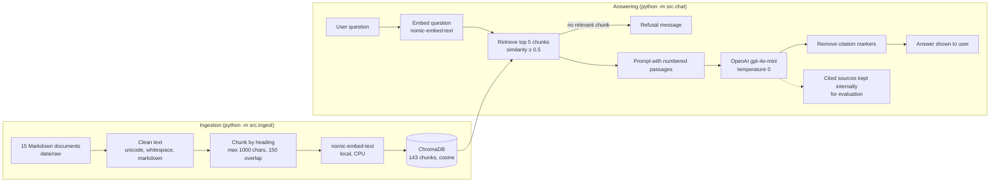

# Dental FAQ Chatbot (Sweden)

A Python chatbot that answers common dental questions for people in Sweden, built with a Retrieval-Augmented
Generation (RAG) pipeline in LangChain. It covers general dental care (cavities, gum disease, root canals,
implants, emergencies, mouth sores, children's teeth, whitening, braces and more) and the Swedish dental care
system (tandvårdsbidrag, högkostnadsskydd, tiotandvård, free dental care for children and young people).

The chatbot answers only from its own knowledge base. If the answer isn't there, it says so instead of guessing.

> **Disclaimer:** This is a portfolio project. The answers are general information, not medical advice or a
> diagnosis. The knowledge base was written for this project, and several prices are rough estimates.

## Example

```
You: How much tandvårdsbidrag does a 25 year old get?
Bot: A 25-year-old receives 600 SEK per year in tandvårdsbidraget.

You: How much does a filling cost at Folktandvården in Malmö in 2027?
Bot: A simple filling at Folktandvården typically costs between 500–1,200 SEK depending on size and
     complexity. I don't have information about the specific cost in Malmö in 2027.

You: What is the capital of France?
Bot: I'm sorry, I don't have enough information to answer that question.
```

## Features

- **Grounded answers:** The LLM may use only the retrieved passages. It must mark every sentence with the passage
  it came from. These markers are removed before the answer is shown, but they are kept internally for checking.
- **Natural answers:** Users see plain text with no citations, file names, or source references.
- **Honest refusals:** Questions outside the knowledge base get a fixed refusal message. Questions with no
  relevant passage at all are refused without calling the LLM.
- **Partial answers:** If a question asks for a detail that isn't covered, such as a price in a specific city,
  the bot gives the general information and says which detail it doesn't have.
- **Local embeddings:** nomic-embed-text runs on your own machine with sentence-transformers. Ollama is not needed.
- **Evaluation:** A test harness measures retrieval relevance, answer accuracy, faithfulness, and completeness,
  with a held-out test set and before/after comparison.

## Architecture



1. **Ingestion:** Each document is cleaned and split at its `#` and `##` headings, so every FAQ question becomes
   one chunk. Each chunk starts with its heading (for example "The Swedish Dental Subsidy System > What is
   tiotandvård?") so the embedding knows what question the text answers. The metadata stores the file name,
   title, section, and a stable chunk ID.
2. **Retrieval:** The question is embedded with the `search_query:` prefix (chunks use `search_document:`, as
   nomic-embed-text requires). ChromaDB returns the 5 most similar chunks, and chunks below 0.5 cosine similarity
   are dropped.
3. **Generation:** gpt-4o-mini answers using only the numbered passages. It cites each sentence internally, and
   it is told not to add facts from its own knowledge.
4. **Output:** Citation markers are stripped. The answer, the cited sources, and the retrieved passages are all
   returned in a `RagResult` object, but only the answer text is shown to the user.

## Technologies

| Purpose | Technology |
|---|---|
| Language | Python 3.13 |
| RAG framework | LangChain (`langchain-core`, `langchain-openai`, `langchain-chroma`, `langchain-text-splitters`) |
| Embeddings | [nomic-embed-text-v1.5](https://huggingface.co/nomic-ai/nomic-embed-text-v1.5) via `sentence-transformers` (768 dimensions) |
| Vector database | ChromaDB (local, persistent) |
| LLM | OpenAI `gpt-4o-mini` |
| Evaluation judge | OpenAI `gpt-4.1-mini` with structured output (Pydantic) |
| Configuration | `python-dotenv` |

## Project structure

```
dental-faq-chatbot/
├── data/raw/              # Knowledge base: 15 Markdown documents
├── src/
│   ├── config.py          # All settings: paths, models, chunking, top_k, threshold, prompt version
│   ├── embeddings.py      # LangChain wrapper for local nomic-embed-text
│   ├── vectorstore.py     # ChromaDB connection
│   ├── ingest.py          # Clean, chunk, embed and store the documents
│   ├── rag_chain.py       # Retrieval, prompts (v1-v3), answer generation
│   └── chat.py            # Terminal chat
├── scripts/
│   ├── test_embeddings.py # Check that the embedding model works
│   ├── test_retrieval.py  # Check that 17 questions retrieve the right document
│   ├── test_rag.py        # Check 8 answers for grounding and leaks
│   └── check_openai.py    # Check the API key and model
├── evals/
│   ├── dev_questions.json, test_questions.json
│   ├── run_eval.py        # Run an evaluation
│   ├── judge.py           # LLM judge with quote verification
│   ├── sweep_retrieval.py # Compare top_k values (no API calls)
│   ├── analyze.py, compare.py
│   ├── REPORT.md          # Full evaluation report
│   └── results/           # All evaluation runs (older ones in archive/)
├── requirements.txt
└── .env.example
```

## Setup

Requirements: Python 3.13 (tested with 3.13.7), about 2 GB of free disk space for packages and the embedding
model, and an OpenAI API key with credit.

```bash
git clone <your-repo-url>
cd dental-faq-chatbot

python3 -m venv .venv
source .venv/bin/activate
pip install -r requirements.txt

cp .env.example .env
# Open .env and replace the placeholder with your OpenAI API key

python -m scripts.check_openai   # optional: checks that the key works
python -m src.ingest             # builds the ChromaDB index
```

The first run of `src.ingest` downloads the nomic-embed-text model (about 550 MB) to `~/.cache/huggingface`.
Embedding all 143 chunks then takes about 10 seconds on a laptop CPU.

**Notes**
- `transformers` is pinned below version 5. The nomic-embed-text model code uses a function that was removed in
  transformers 5.
- The embedding model runs on CPU (`EMBEDDING_DEVICE` in `src/config.py`). PyTorch's Apple GPU backend crashed on
  macOS 14.5, and CPU is fast enough for this knowledge base.
- `chroma_db/` and `data/processed/` are generated by `src.ingest` and are not in Git. Run it again after
  editing a document.

## Usage

**Chat in the terminal**
```bash
python -m src.chat
```
Type a question and press Enter. Type `quit` to exit.

**Use it from Python**
```python
from src.rag_chain import DentalRAG

rag = DentalRAG()
result = rag.ask("How does högkostnadsskyddet work?")
print(result.answer)      # what the user sees
print(result.sources)     # passages the answer is based on (internal)
print(result.retrieved)   # all retrieved passages with similarity scores (internal)
```

**Quick checks**
```bash
python -m scripts.test_retrieval   # retrieval on 17 questions
python -m scripts.test_rag         # 8 answers: grounding, refusals, no leaks
```

**Configuration:** Settings live in `src/config.py`. The main ones are `TOP_K` (5), `MIN_SIMILARITY` (0.5),
`LLM_MODEL` (`gpt-4o-mini`), and `PROMPT_VERSION` (`v3`).

## Evaluation

The chatbot was evaluated on predefined dental questions for retrieval relevance, answer accuracy, and response
completeness. The retrieval settings and prompt were then refined based on the results, and the final version
was verified on a separate test set. See [evals/REPORT.md](evals/REPORT.md) for the full report.

**Method**
- **Question sets:** 44 dev questions for tuning and 26 test questions, phrased differently, held back until the
  end. Each question lists the sections that should be retrieved and the facts a complete answer must contain.
- **Retrieval metrics:** Hit@k, Recall@k, MRR, and Precision@k against the expected sections, computed
  automatically.
- **Answer scoring:** Done by an LLM judge (`gpt-4.1-mini`, a different model from the chatbot):
  - correctness from 1 to 5
  - completeness, as the share of reference facts covered
  - faithfulness: the judge must quote the passage behind each claim, and code checks that the quote is real
- **Fair comparison:** The judge, scoring code, and questions were frozen before the baseline, and their hashes are
  in `evals/FROZEN_EVAL_HASHES.txt`. Runs with different criteria can't be compared, and each configuration was
  run 3 times to measure noise.

**Changes made:** `top_k` was raised from 4 to 5. The prompt was revised twice: v1 asked for brief answers, and v3
asks for complete answers, combines overlapping passages, gives partial answers, and refuses less often.

**Results on the held-out test set** (mean of 3 runs each)

| Metric | Baseline (top_k=4, prompt v1) | Final (top_k=5, prompt v3) |
|---|---|---|
| Completeness | 81.6% | **85.4%** |
| Correctness (1-5) | 4.59 | **4.70** |
| Retrieval Recall@k | 90.9% | **93.2%** |
| Answer accuracy | 95.5% | 95.5% |
| Faithfulness | 87.9% | 89.4% (within run-to-run noise) |
| Correct refusals (out of scope) | 100% | 100% |
| False refusals | 0% | 0% |

On the dev set, completeness rose from 89.2% to 92.9% and leaks dropped from 2.3% to 0%.

**Run the evaluation**
```bash
python -m evals.sweep_retrieval --set dev                     # retrieval only, no API calls
python -m evals.run_eval --set dev --tag my_run               # full evaluation with current settings
python -m evals.compare evals/results/baseline__dev.json evals/results/my_run__dev.json
```
New runs never overwrite old results. An existing file is first copied to `evals/results/archive/`.

## Known limitations

- **Generic advice:** The bot sometimes adds advice that isn't in the knowledge base, such as "consult a dental
  professional".
- **Vocabulary mismatch:** Retrieval misses some everyday wordings. "Eating ice cream hurts my teeth" does not
  find the sensitive-teeth section.
- **Medicine doses:** Questions about medicine doses are refused completely, so the user also misses related
  advice, for example that antibiotics alone don't cure an abscess.
- **Missed warning sign:** For a mouth sore that hasn't healed in three weeks, the answer recommends a check-up but
  doesn't mention that it can be an early sign of oral cancer.
- **Similarity threshold:** The 0.5 threshold only blocks completely unrelated questions. Dental-related
  out-of-scope questions are refused by the prompt.
- **Small evaluation sets:** 44 and 26 questions show large effects only. Differences of a few points in
  faithfulness are within the noise.
- **LLM judge:** It was calibrated, but individual judgements can still be wrong. All answers and judgements are
  saved for manual review.
- **Knowledge base accuracy:** The knowledge base was not independently fact-checked. Rules and prices for
  Swedish dental care change, so check current information with
  [Försäkringskassan](https://www.forsakringskassan.se) or [1177](https://www.1177.se).
- **Language:** The chatbot answers in English only, and it has no conversation memory, so each question is
  answered on its own.
- **Costs:** Each answer is an OpenAI API call, which costs a fraction of a cent with gpt-4o-mini.
